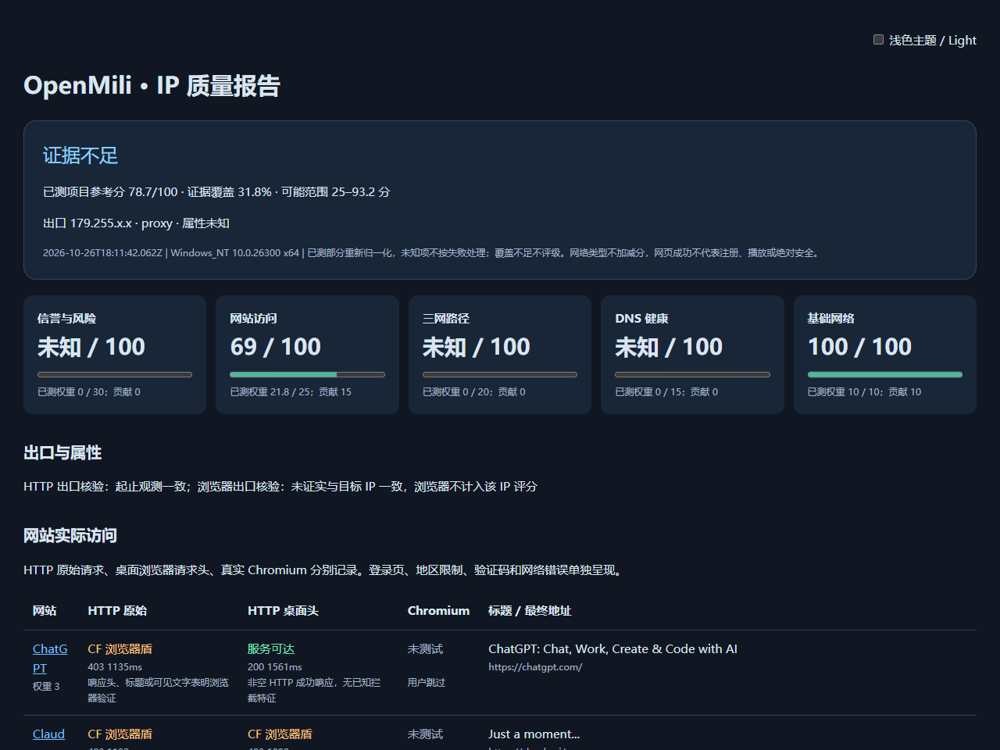

# OpenMili IP Toolkit

检测**运行本机或指定代理的真实出口 IP**：公开库与 ASN、三网回程、IP 历史、网站普通 HTTP / 浏览器模拟标头检测，全部结果直接在终端排版展示。

## 一键脚本（推荐）

只保留两个菜单，默认运行完整检测。需要 [Node.js 20+ LTS](https://nodejs.org/)（含 npm）和系统 curl。

Windows PowerShell：

```powershell
irm https://raw.githubusercontent.com/OpenMili/OpenMili-IP-Toolkit/main/simple-ip-check.ps1 | iex
```

Linux/macOS/Git Bash：

```bash
curl -fsSL https://raw.githubusercontent.com/OpenMili/OpenMili-IP-Toolkit/main/simple-ip-check.sh | sh
```

启动页显示脚本名称、GitHub 地址、系统和当前直连公网 IPv4/IPv6。输入 `1` 开始；输入 `2` 自定义代理端口（默认 7890，支持 HTTP/SOCKS 完整地址）。IPv4/IPv6 使用 `curl -4`、`curl -6` 和各自专属的公网回显域名，避免代理远端解析优先 IPv6 导致漏报 IPv4；不使用网关或内网地址冒充公网出口。

默认依次检测：公开库/ASN 交叉核验、IP 属性与风险、DNS/PTR、三网路径、注册与近 90 天 BGP 历史、全部 38 个网站的普通 HTTP / 浏览器模拟标头，以及五维评分。网站两次请求均由 curl 发送，模拟标头包含桌面 Chrome User-Agent、Accept、Accept-Language、Sec-Fetch 等，不执行 JavaScript。启用公开社区来源 ipapi.is；增强举报来源需要 `ABUSEIPDB_API_KEY`，缺少密钥或证据显示未知。ASN/所有者不能单独证明住宅，网站首页可访问也不能保证注册、播放或绝对安全。

**Windows 无需换 Linux。** 两者使用同一个检测内核；Windows 的路由使用原生 `tracert`（ICMP），Linux 安装 `traceroute` 后可按权限测 ICMP/TCP/UDP。**HTTP/SOCKS 代理无法做远端三网回程**，此项说明原因后跳过；测 VPS 回程需要在该 VPS 本机运行。

远程运行时自动在临时目录获取完整脚本和核心依赖，完成后清理，不注册系统服务。简单入口不启动 Edge/Chrome/Chromium，不下载 Playwright 或浏览器。

默认不生成报告文件或截图。终端只展示 IP/ASN、风险、DNS/三网/历史汇总、38 站两列状态表和评分；详细逐条证据仅在报告模式查看。**通过绿色、验证码/浏览器验证黄色、阻断/失败红色、未知/跳过灰色**；同一行对比“普通 HTTP / 浏览器标头”，保留状态码。中文列宽自动对齐，窄屏改为逐站多行，`NO_COLOR` / `--plain` 使用无色文字。

Windows 结束仅提示“按回车键结束”，保留当前 PowerShell。自动运行可用 `-NoPause`（PowerShell入口）或 `--no-pause`（Node入口）。需要额外保存文件时，本地 Node 入口加 `--save-report`，或显式指定 `--output 目录`；此时另存 HTML/TXT/JSON/Markdown，不影响终端完整展示。

本地同样使用简单菜单，支持完整内核选项：

```bash
npm ci
node simple-ip-check.js
node simple-ip-check.js --output ./my-reports --no-install
node simple-ip-check.js --ipv6
```

公网双栈分别发现；网站与评分每次使用一个协议族，默认 IPv4、只有 IPv6 时自动切换。需要比较两个出口时分别运行，第二次加 `--ipv6`，不会把 IPv4 和 IPv6 的网站结果混算。

## 本地运行

蓝图补齐进度与边界见 [开发计划](docs/DEVELOPMENT_PLAN.md)；包含独立子命令、可复现评分和稳定报告协议：

```bash
node bin/openmili.js lookup --ip 8.8.8.8 --json
node bin/openmili.js port --host example.org --port 443 --tls --samples 3
node bin/openmili.js ip --ipv6
node bin/openmili.js doctor --offline
```

原生同语义入口：Windows `.\openmili.ps1`；Linux/macOS `sh ./openmili.sh`。`lookup` 只查指定 IP 的公开库，绝不启动网站/路由实测。`--redact` 适合分享报告，`--offline` 禁止网络查询。详情、配置、退出码与 schema 见 [CLI 协议](docs/CLI.md)。

```bash
npm ci
node bin/openmili.js
node bin/openmili.js --mode proxy --proxy socks5h://127.0.0.1:10808
node bin/openmili.js --mode direct --limit 5 --no-routes --no-pause
node bin/openmili.js --mode direct --family 6
node bin/openmili.js --lookup-ip 8.8.8.8 --only-lookup --no-pause
node bin/openmili.js --help
```

Windows 也可双击 `run.cmd` 或使用 `run.ps1`；Linux 可用 `bash run.sh`。这两个入口共用同一个检测核心，首次本地运行会自动 `npm ci`。

```powershell
.\run.ps1 -Mode proxy -Proxy socks5h://127.0.0.1:10808 -NoPause
.\run.ps1 -Mode direct -Limit 5 -NoBrowser -NoRoutes -NoPause
```

## 检测内容

| 模块 | 实际检查与边界 |
|---|---|
| 出口 IP | 多个 HTTPS 服务交叉观测 IPv4/IPv6，读取并标明 HTTP_PROXY/HTTPS_PROXY/NO_PROXY；可用 --ignore-env-proxy 禁用，显式代理覆盖 NO_PROXY。HTTP 开始/结束与浏览器开始/结束分别核验，出口变化或无法核验时不混入该 IP 评分。 |
| IP 属性 | RIPE RIS、Team Cymru 交叉核对 ASN/前缀，IANA 引导官方 RIR RDAP。ASN 所有者名称和内置 ASN 映射先给低置信度机房/运营商/移动倾向；有独立 IP/前缀类型证据后再提高置信度，冲突保留未知。 |
| DNS | 系统配置/getaddrinfo、UDP/TCP/DoH/DoT、A/AAAA/CNAME/MX/TXT/PTR 及正反向回查；保留 RCODE/耗时/差异，不把 CDN 差异当污染。 |
| 公开库风险 | 仅使用服务实际返回的 Tor、代理、VPN、滥用字段；免费服务省略字段或限流时保留未知。机房属性本身不扣分。 |
| 三网回程 | 有来源的北京、上海、广州三网九组双栈域名；DNS/BGP 归属核验、逐跳 ASN/RTT/匿名跳与健康历史，ICMP/TCP/UDP 按平台能力执行。城市仍需核实，不以 ASN 断言 CN2 GIA。 |
| IP 历史 | 官方 RIR RDAP 网段注册/修改事件、当前精确宣告前缀近 90 天 BGP 起源。不会把上级网段历史、BGP 变化或注册年龄当作滥用记录。 |
| 举报历史 | 设置环境变量 `ABUSEIPDB_API_KEY` 后查询近 90 天举报。未配置、无返回或无举报不证明没有滥用历史，密钥不写入报告。 |
| 网站实测 | 默认 38 个版本化分类目标，原始 HTTP、桌面浏览器请求头和可选真实 Chromium 三种方式。包含 ChatGPT、Claude、Scholar、Reddit、Grok、Quora、ScienceDirect 等验证目标，各站权重可调。 |
| 风控证据 | 区分验证码、CF 盾、地区限制、登录、429 限流、空白、JS 要求、网络错误；记录状态码、耗时、标题、可见文字片段、最终地址，异常浏览器页面截图。不会绕过验证码。 |
| 本地历史对比 | 与同一报告根目录的上一次相同出口报告比较网站结果；`latest.json` 保留最近一次完整报告。 |

回程是在**运行脚本的机器**上执行，不穿过 HTTP/SOCKS 代理。代理模式会跳过回程；需要测 VPS 回中国方向时，请在该 VPS 本机运行。Linux 优先使用 `traceroute`，缺少时尝试 `tracepath`。不响应 ICMP 不等于线路差。

三网 IPv4/IPv6 分别测量；Windows 原生仅支持 ICMP，Linux 需 traceroute 及对应权限。见 [路由方法](docs/ROUTING_METHOD.md) 和 [站点规则](docs/WEBSITE_RULES.md)。

网站可达只证明本次页面访问。浏览器指纹、地区、账户、时间及代理按目标分流都会影响结果，不能保证“绝对好 IP”，也不代表登录、播放、支付已解锁。默认 HTTP 固定 IPv4，只有 IPv6 出口时改用 IPv6；直连浏览器若实际用了不同协议，其结果保留但不混入该 IP 评分。

直连 Chromium 通过临时本机回环桥固定所选 IPv4/IPv6；它只转发 TCP，不解密 TLS，退出即关闭。这样可避免浏览器优先 IPv6、HTTP 使用 IPv4 时混合两个 IP 的检测结果。

## 综合评分

P1 数据源默认免 Key；`--community-sources`、`IPAPI_API_KEY`、`IPINFO_TOKEN` 按授权开启增强类型库。缓存、隐私、配额与来源许可见 [API 说明](docs/API_PROVIDERS.md)，分类规则见 [证据融合](docs/CLASSIFICATION_RULES.md)，DNS 见 [协议检测](docs/DNS.md)。

| 维度 | 权重 |
|---|---:|
| 信誉与风险 | 30 |
| 网站实际访问 | 25 |
| 三网路径 | 20 |
| DNS 健康 | 15 |
| IP 网络基础能力 | 10 |

未知项重新归一化，同时显示有效覆盖率；不足 60% 不提供综合等级。类型与注册年龄不计分，每项结果有实际证据引用。模型权重、状态因子与等级阈值可配置；报告保存标准化输入和完整模型，支持 `score --input report.json --json` 离线重放。见 [评分公式](docs/SCORING.md)。

终端支持单项菜单、重试、中英文、NO_COLOR、窄屏和 JSON；报告包含离线单文件 HTML（主题、图表、逐跳与内嵌截图）、JSON、Markdown、TXT、ANSI。详见 [报告与终端](docs/REPORTS.md)。

## 自定义目标与选项

`domains.yaml` 支持 `name`、`url` 和可选 `weight`（1–3），重复 URL 去重，不接受别名、凭据和非 HTTP/HTTPS URL：

```yaml
domains:
  - name: Google Scholar
    url: https://scholar.google.com/
    weight: 3
```

```bash
node bin/openmili.js --urls domains.yaml --output ./my-reports
node bin/openmili.js --targets-url https://example.com/domains.yaml
node bin/openmili.js --port 7890 --no-browser
node bin/openmili.js --no-install-browser --browser-path /usr/bin/chromium
node bin/openmili.js --headed --screenshots
```

`--targets-url` 上限 100 KiB，下载只驻留内存。所有 HTTP 请求有超时、大小上限和重定向上限，并验证 TLS；不使用 `curl -k`。截图与报告仅写在本机。截图可能包含访问页面内容，请按需保管。

## 实际报告截图

下图来自本机已保存的38站HTTP实际观测，按当前评分重新渲染并脱敏；未执行的浏览器/数据库/路由保留未知，截图不是全项通过示例。



## 验证

```bash
npm test
npm run smoke
npm pack --dry-run
```

回归覆盖 HTTP/浏览器误判、JavaScript 渲染、代理 `NO_PROXY`、重定向最终响应头、YAML、IPv4/IPv6、公网校验、回程解析、ASN 冲突、历史前缀过滤、缺失证据评分和报告转义。GitHub Actions 配置 Windows/Linux、Node 20/24 矩阵，测试时安装真实 Chromium。

backtrace 参考和 MIT 许可见 [THIRD_PARTY_NOTICES.md](THIRD_PARTY_NOTICES.md)。

## 便携安装与远端

[Releases](https://github.com/OpenMili/OpenMili-IP-Toolkit/releases) 提供包含运行时的便携包与 SHA256SUMS；先检查安装脚本源码，再运行 `install.sh` / `install.ps1`。支持用户级安装、校验、自检后升级、保留上一版、`rollback` 和 `uninstall --yes`。默认保留配置、密钥和报告，不删除系统软件。平台范围与操作见 [安装说明](docs/INSTALLATION.md)。

`agent --ssh user@host --remote-path /absolute/openmili-ip --task all` 在已授权、预先安装的POSIX SSH主机执行，严格验证主机密钥，报告保留远端出口与环境；失败不会替换为本机测量。见 [Agent说明](docs/AGENT.md)。

[English](README_EN.md) · [变更记录](CHANGELOG.md) · [安全说明](SECURITY.md) · [参与开发](CONTRIBUTING.md) · [许可](LICENSE)
